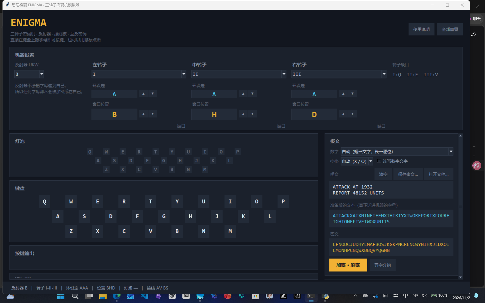
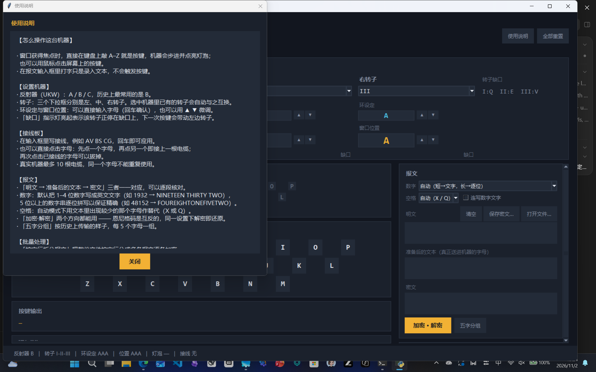

# ENIGMA · 恩尼格码模拟器

一个用 Python 编写的**恩尼格码（Enigma）加密机模拟器**，带完整的中文桌面界面。
模拟的核心严格遵循真实机器的电气与机械行为：转子步进、**双步进（double stepping）**、
转子环设定（Ringstellung）、接线板（Steckerbrett）以及反射器（Umkehrwalze）。

> A faithful Python simulation of the Enigma cipher machine with a full desktop
> GUI: rotor stepping, double stepping, ring settings, plugboard and reflector.



界面右上角的 **使用说明** 里有完整操作指引：



---

## 功能特性

| 功能 | 说明 |
| --- | --- |
| **全中文界面** | 所有面板、按钮、提示、状态栏均为中文，并内置「使用说明」窗口 |
| 完整机器模型 | 三转子（I–VIII）+ 反射器（A/B/C）+ 接线板，电气路径逐跳可追溯 |
| 真实步进规则 | 按键前步进、双步进异常、转子缺口（turnover notch）触发 |
| **键盘直接输入** | 直接敲 A–Z 即按键；输入框内打字则正常录入文本 |
| **参数直接填写** | 环设定与窗口位置可直接输入字母；接线可直接写 `AV BS CG` 回车生效 |
| **长文本 / 批量加密** | 打开 `.txt`、保存密文、按空行拆分成多条报文、逐条重新起转子、进度条与统计 |
| **报文准备** | 数字自动改写为英文文字或逐位拼写，空格自动替换为 X 或 Q，并显示"准备后"的文本 |
| 交互式 GUI | 灯板、键盘、三个转子控制面板、接线板编辑器、报文加解密 |
| 信号路径显示 | 实时显示电流经过 插头板 → 右转子 → 中转子 → 左转子 → 反射器 → 返回 的每一跳 |
| 参考向量测试 | 80 个单元测试，覆盖公开的历史参考向量与界面交互 |

## 快速开始

项目使用**虚拟环境**管理依赖（运行时零第三方依赖，只用标准库 `tkinter`）。

### Windows (PowerShell)

```powershell
python -m venv .venv
.\.venv\Scripts\Activate.ps1
python -m pip install -r requirements.txt
python run.py
```

### macOS / Linux

```bash
python3 -m venv .venv
source .venv/bin/activate
python -m pip install -r requirements.txt
python run.py
```

> Linux 上若缺少 tkinter：`sudo apt install python3-tk`。

可选的开发/测试工具：

```powershell
python -m pip install -r requirements-dev.txt
pytest
```

## 界面说明

界面为**全中文**。点右上角 **使用说明** 可以随时查看操作指引。

* **机器设置**（顶部）
  * *反射器 UKW*：选择 A / B / C。B 是绝大多数真实战时电文使用的反射器。
  * *左 / 中 / 右转子*：下拉框选择转子类型（I–VIII）。
    **环设定**与**窗口位置**都可以**直接输入字母**（回车确认），也可以用 `▲ ▼` 微调。
    转子停在缺口上时，下面的 **缺口** 指示灯会亮起。
  * 选择一个已经在机器中的转子时，两个转子会**自动互换**（同一转子不能装两次）。
* **接线板 Steckerbrett**
  * 最省事的做法：在输入框里写接线（例如 `AV BS CG`），按回车或点 **应用**。
  * 也可以点击字母板：先点一个字母，再点另一个即接一根电缆；再次点击已接线的字母可拔掉。
  * 真实机器最多 10 根电缆，且同一字母不能重复使用。
* **灯泡 / 键盘**：**直接用真实键盘敲 A–Z 就是按键**（窗口获得焦点时），也可以点击屏幕上的按键；
  机器随即步进并点亮对应灯泡，同时把结果追加到 **按键输出**。
  在报文输入框里打字则只是正常录入文本，不会触发按键。
* **报文**（右侧最上方，最常用的操作不用滚动）
  * *数字* / *空格*：报文准备规则，见下文。
  * *明文*：粘贴或用 **打开文件…** 载入 `.txt`；**保存密文…** 把密文写回文件。
  * *准备后的文本*：显示**真正送进机器的字母**（数字已改写、空格已替换）。
  * *密文*：结果。**加密 · 解密** 两个方向都能用（恩尼格码互反），**五字分组** 按历史格式分组。
* **批量处理**
  * `按空行拆分报文`：把文本按空行拆成多条报文，逐条加密。
  * `每条报文前复位转子`：模拟"每条报文都换新密钥"。
  * 长文本按每 2000 字母分块处理，界面不卡死，并显示进度条与统计（字母数、报文数、耗时）。
* **信号路径**：显示上一次按键时电流在机器内部的完整路径。

## 报文准备：数字与空格

恩尼格码只认识 26 个字母，所以真实电文里数字要先写成字母、空格要用别的字母代替。

### 数字

界面上的 **数字** 下拉框有三种策略：

| 策略 | 规则 | 例子 |
| --- | --- | --- |
| `自动（短→文字，长→逐位）`（默认） | 1–4 位数字按可读文字改写；5 位及以上的数字串视为必须精确保留的编号，逐位拼写 | `1932` → `NINETEEN THIRTY TWO`，`48152` → `FOUREIGHTONEFIVETWO` |
| `文字（可读）` | 所有数字都写成英文文字 | `1932` → `NINETEEN THIRTY TWO` |
| `逐位拼写（精确）` | 所有数字都逐位拼写并直接拼接 | `1932` → `ONENINETHREETWO` |

四位数字按**英式年份读法**（`1932` = *nineteen thirty-two*，`2001` = *twenty-oh-one*）；
带千位分隔符的数字（`1,234`）按数量读作 `ONE THOUSAND TWO HUNDRED THIRTY FOUR`。
勾选 **连写数字文字** 可把数字的文字连写（`NINETEENTHIRTYTWO`），这是德军当时的常见写法。

### 空格

**空格** 下拉框决定空格用什么字母代替：

* `自动（X / Q）`（默认）：统计**报文准备后**文本里 `Q` 与 `X` 出现的次数，**用出现得少的那个**作空格替代字母
  （平局时用 `X`）。这样替代字母不会与报文本身混淆。
  例：文本里有 3 个 `X`、0 个 `Q` → 用 `Q` 代空格。
* `X` / `Q`：强制指定。

> 数字文字里的空格同样按此规则替换，因此 `1932` 在默认设置下会变成 `NINETEENXTHIRTYXTWO`；
> 勾选 **连写数字文字** 则得到 `NINETEENTHIRTYTWO`。

其余标点符号在送入机器前一律丢弃。

## 机器模型

信号路径（每次按键）：

```
插头板 → 右转子 → 中转子 → 左转子 → 反射器 → 左转子 → 中转子 → 右转子 → 插头板
```

* **转子变换**：转子接线为 `W`，窗口位置为 `p`，环设定为 `r`，则有效偏移量为
  `e = (p − r) mod 26`；正向（自右向左）变换为 `W[(l + e) mod 26] − e`，
  反向为 `W⁻¹[(l + e) mod 26] − e`。
* **步进**：每次按键**先**步进。右转子总是步进；右转子处于缺口、或中转子自身处于缺口时，
  中转子步进；中转子处于缺口时左转子随之中转子一起步进 —— 这就是著名的**双步进**。
* **缺口（turnover letters）**：I→Q、II→E、III→V、IV→J、V→Z，VI/VII/VIII→Z+M。
  缺口位于字母环上，因此改变环设定**不会**改变步进节奏。
* **互反性**：反射器没有自连点，因此没有接线板时任何字母都不会被加密成它自己；
  同一台机器同一设置下，加密与解密互为逆运算。

## 正确性验证

`tests/` 中的测试全部基于公开的历史参考向量（Wikipedia / Crypto Museum）：

| 设置 | 明文 | 期望密文 |
| --- | --- | --- |
| 转子 I-II-III，反射器 B，环设定 AAA，起始 AAA | `AAAAA` | `BDZGO` |
| 同上，26 个字母（会触发一次转子交接） | `A`×26 | `BDZGOWCXLTKSBTMCDLPBMUQOFX` |
| 同上，环设定 `BBB`（即 02-02-02） | `AAAAA` | `EWTYX` |
| 加密后再解密（互反性） | `ATTACKATDAWN` | 还原原文 |
| Wikipedia 的标准步进序列 | — | `ADU → ADV → AEW → BFX → BFY` |

此外还覆盖：数字改写规则、空格替代规则、插头板约束、以及界面交互
（键盘按键、报文准备、批量拆分、长文本分块处理）。

运行测试：

```powershell
python -m unittest discover -s tests -v     # 仅用标准库
pytest                                       # 使用 pytest
```

## 项目结构

```
Enigma machine/
├── enigma/                 # 与界面无关的模拟核心
│   ├── data.py             # 转子接线、缺口、反射器接线表
│   ├── plugboard.py        # Steckerbrett（插头板）
│   ├── machine.py          # 机器模型、步进规则、加解密
│   ├── numbers.py          # 数字改写：英文文字 / 逐位拼写
│   ├── preparation.py      # 报文准备：数字改写 + 空格替代（X/Q）
│   └── message.py          # 报文规范化、五字母分组、按空行拆分
├── enigma_gui/             # Tkinter 桌面界面
│   ├── theme.py            # 配色与字体
│   ├── widgets.py          # 灯板、键盘、转子面板、插头板、信号路径
│   └── app.py              # 主窗口
├── tests/                  # unittest 测试（参考向量 + 界面交互）
├── docs/screenshot.png
├── run.py                  # 程序入口
├── requirements.txt        # 运行时依赖（空：仅标准库）
├── requirements-dev.txt    # 开发依赖（pytest）
└── pyproject.toml
```

核心库可以脱离界面单独使用：

```python
from enigma import EnigmaMachine, Plugboard, prepare_text

# 参考向量设置：转子 I-II-III，反射器 B，无接线板，起始 AAA
eng = EnigmaMachine.create(
    rotor_order=("I", "II", "III"),
    reflector="B",
    plugboard=Plugboard(),
    ring_settings=("A", "A", "A"),
    positions=("A", "A", "A"),
)
print(eng.encrypt("AAAAA"))   # -> BDZGO

# 报文准备：数字改写 + 空格替代
prepared = prepare_text("ATTACK AT 1932", number_policy="auto")
print(prepared.space_letter)  # -> X（文本里 Q 比 X 少）
print(prepared.text)          # -> ATTACKXATXNINETEENXTHIRTYXTWO

# 带接线板的日常设置
eng = EnigmaMachine.create(
    rotor_order=("I", "II", "III"),
    reflector="B",
    plugboard=Plugboard.parse("AV BS CG"),
)
print(eng.encrypt("ATTACKATDAWN"))
```

## 数据来源

* 转子接线、缺口位置、反射器接线：Wikipedia《Enigma machine》转子表与
  “Turnover notch positions”，以及 [Crypto Museum](https://www.cryptomuseum.com/crypto/enigma/)。
* 参考向量与步进序列：Wikipedia 的 “Normalized Enigma sequences” 与相关密码学文献。
* 单元测试会校验：每台转子的接线是字母表的排列；每个反射器是**无自连点的对合**（involution）。

## 说明与已知限制

* 模拟的是三转子的陆海军用恩尼格码（M3）。四转子 M4（薄反射器 Beta/Gamma）未纳入界面，
  但 `enigma/data.py` 中保留了 `B thin` / `C thin` 两款薄反射器接线。
* 历史上真实电文会先用转子/插头板设置加密一个消息密钥，再换新设置加密正文；
  本程序只提供单机操作与整段加解密，不含密钥流程（Kenngruppenverfahren）。
* 界面为单屏布局，窗口会自动适配屏幕尺寸。

## 许可

MIT
