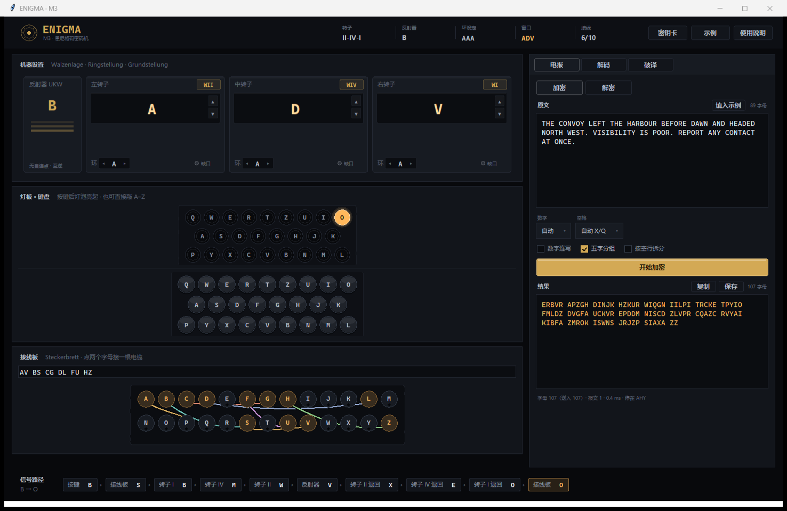
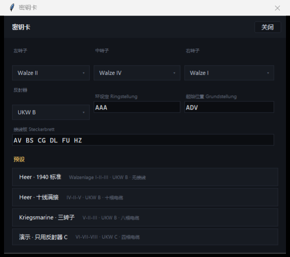
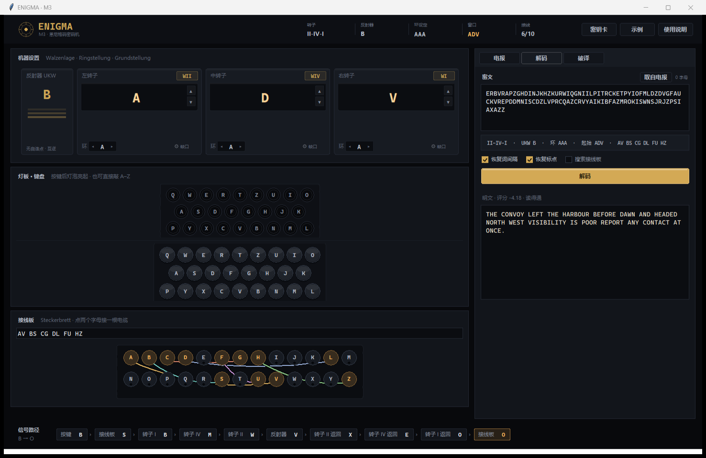
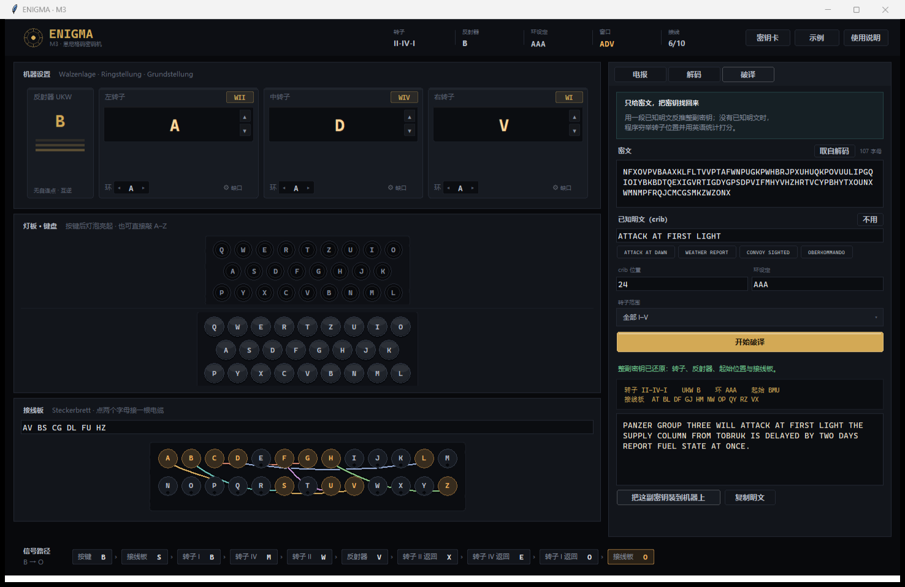
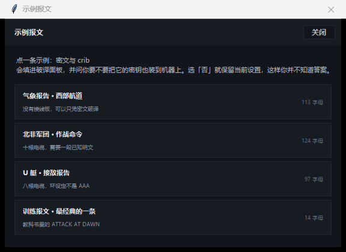

# ENIGMA · M3

一台可以直接使用的**恩尼格码机**：三转子、反射器、接线板全部可操作，
加密解密严格遵循真实机器的电气与机械行为，并内置**自动破译**——
只给一段密文，把密钥和明文一起找回来。

界面是**原生 Windows 桌面窗口**（Python 标准库 Tk 手绘，没有网页、不内嵌浏览器、
不需要装 GUI 框架），除了「破译」需要 numpy，其余全部零依赖。



---

## 目录

- [开箱即用](#开箱即用)
- [界面导览](#界面导览)
- [加密与解密](#加密与解密)
- [自动破译](#自动破译)
- [内置示例](#内置示例)
- [快捷键与鼠标](#快捷键与鼠标)
- [Python 库用法](#python-库用法)
- [项目结构](#项目结构)
- [正确性验证](#正确性验证)
- [已知限制](#已知限制)
- [数据来源与许可](#数据来源与许可)

---

## 开箱即用

### Windows：双击 `start.bat`

它会自己找 Python、缺 numpy 就装一次，然后打开机器窗口。关掉窗口程序就退出。

命令行方式：

```powershell
python -m venv .venv
.\.venv\Scripts\Activate.ps1
python -m pip install -r requirements.txt
python run.py
```

### macOS / Linux

```bash
python3 -m venv .venv && source .venv/bin/activate
python -m pip install -r requirements.txt
python run.py
```

> 界面用 Tk，CPython 自带；Linux 上若提示缺少 tkinter：`sudo apt install python3-tk`。
> 唯一的外部依赖是 **numpy**，只有「破译」用到；没装时其余功能照常工作，
> 破译面板会提示怎么装。Python 3.9 以上。

窗口默认 1460×920，可以拉到 1180×700；窗口变小时机器栏与工作台各自滚动。

---

## 界面导览

左半屏是机器，右半屏是工作台，底部一条**信号路径**。

**机器设置**：左端是反射器（UKW），右边三个是左 / 中 / 右转子。
点型号标签 `W I` 换轮子，同一型号不能装两次，装重复时两个转子自动互换；
大字母是窗口位置，`▲ ▼` 步进；下面的 `环 ◀ A ▶` 是环设定（Ringstellung）。

**灯板 · 键盘**：按一个键，机器先步进，再点亮对应的灯泡。
**直接用实体键盘敲 A–Z 就是按键**（焦点不在输入框时）。

**接线板**：点一个字母再点另一个就接上一根电缆，再点已接线的字母把它拔掉；
也可以在输入框里写 `AV BS CG` 回车生效。最多十根，同一字母只能用一次。

**信号路径**（底部）：上一次按键时电流经过的每一跳，从接线板 → 右转子 →
中转子 → 左转子 → 反射器 → 再原路折回，每个节点都标出当时的字母。

**工作台**分三个页签：

| 页签 | 做什么 |
| --- | --- |
| **电报** | 输入文字 → 加密；把密文粘回来 → 解密。同一条消息两个方向都是它 |
| **解码** | 已知密钥时把密文还原成**带空格和标点**的明文 |
| **破译** | 不知道密钥：只给密文（和可选的已知明文片段），反推整副密钥 |

右上角三个按钮：**密钥卡**（改 / 随机生成 / 预设 / 复制密钥）、
**示例**（四条内置报文）、**使用说明**。



---

## 加密与解密

恩尼格码是**互反**的：同一台机器、同一套设置，加密和解密是同一个操作。
所以「电报」页签只有一个转换按钮，方向由上面的分段控件切换。

一次转换只会在机器的**副本**上进行，窗口上的转子不会跟着走掉——
你可以反复加密同一段文字而结果不变，也可以先记下起始位置再开始。

### 报文准备：数字与空格

真实电文里没有数字也没有空格，机器只认识 26 个字母。所以发送前要做两件事：

**数字**写成英文。

| 策略 | 规则 | 例子 |
| --- | --- | --- |
| `自动`（默认） | 1–4 位读成文字；5 位以上视为编号，逐位拼写 | `1932` → `NINETEEN THIRTY TWO` |
| `英文文字` | 全部写成英文 | `1932` → `NINETEEN THIRTY TWO` |
| `逐位拼写` | 全部逐位拼写 | `1932` → `ONENINETHREETWO` |

四位年份按英式读法（`1932` = *nineteen thirty-two*）。勾选「数字连写」得到
`NINETEENTHIRTYTWO`，这是德军当时的常见写法。

**空格**用一个报文里最少出现的字母代替：程序统计 `X` 与 `Q` 的出现次数，
用少的那个（平局用 `X`），也可以强制指定。其余标点一律丢弃。

转换后结果框下方会显示字母数、报文数、用时，以及转子停在哪里。
长文本可以按空行拆成多条报文（每条重新起转子），也可以保存成 `.txt`。

---

## 自动破译

三条路，程序会按你手里的信息自动选：

### 1. 密钥已知 —— 解码

把密文粘进「解码」，确认密钥条是加密时那套，点**解码**。
机器还原字母，语言模型补回**词间隔**与**标点**，并给出一个评分
（英语大约在 −3.5 到 −5 之间，越高越像话）。

如果密钥都对却读不懂，多半是接线板不一致：勾上**搜索接线板**，
程序会在后台爬山搜索接线板，界面不会卡住。



### 2. 有已知明文（crib）—— 菜单攻击

这是图灵那台 **Bombe** 做的事，也是唯一能打开「满接十根电缆」报文的方法。

在「破译」里粘入密文，在 crib 里填一段你确信原文中有的文字，
点**开始破译**。程序会反推出**转子顺序、反射器、起始位置和接线板**，
再用还原出的密钥解出全文。

crib 的写法有两条规矩：

- **必须和报文准备后的写法一致**：词间隔在准备后是 `X` 或 `Q`，不是空格。
  界面上正常写空格就行，程序两种读法都会试。
- **环设定要填对**：历史上的 Bombe 也假定环设定已知。界面「环设定」里填的不是
  加密时用的那个，crib 就对不上。

位置不知道就留空，程序会把整篇密文都试一遍（慢得多）。



### 3. 只有密文 —— 全位置扫描

crib 留空时，程序退而穷举：60 种转子顺序 × 反射器 × 17576 个起始位置，
每个都用英语四元组统计打分，最好的几个再用接线板搜索精修。

这条路**只对没有接插线的报文有效**。十根电缆的报文，插线板把统计特征搅乱了，
当年也必须靠已知明文——这不是实现偷懒，是恩尼格码本身的强度。

搜索时会显示正在试哪个转子顺序、已经用了几秒，随时可以点**停止**。

### 它是怎么算的

菜单攻击利用的是插线板的对合性。信号走的是

```
密文 = P(S(P(明文)))        P 插线板，S 转子与反射器
```

因为 `P(P(x)) = x`，上式可以整理成 `P(密文) = S(P(明文))`：
crib 里每一对明密文字母，都把「插线板的值」和「机器核心的值」拴在一起。
把 crib 与密文看成一张字母图，沿着边走，一个连通块只要定下根字母的插线板值，
其余全跟着定下来；而插线板必须是**双射**且**对合**，错误的转子设置推出来的
搭档会自相矛盾，于是被淘汰。活下来的候选都能把 crib 一字不差地解出来，
真正的判据是**整篇报文的语言得分**。

`enigma/autosolve.py` 里的全位置扫描是另一套：把 26³ 个起始位置的转子偏移
做成查找表，密文逐字母流式推进，一次算出所有位置的四元组得分。
一台普通笔记本扫完 60 种转子顺序大约 3–5 秒。

---

## 内置示例

右上角「示例」里有四条报文，点一下就把密文和 crib 填进破译面板，
并问你要不要把它的密钥也装到机器上（选「否」就保留当前设置——
这样你并不知道答案，正好用来试）：

| 示例 | 转子 | 接线 | 用来演示 |
| --- | --- | --- | --- |
| 气象报告 · 西部航道 | III-I-II | 无 | **只凭密文**破译 |
| 北非军团 · 作战命令 | II-IV-I | 10 根 | crib 菜单攻击 |
| U 艇 · 接敌报告 | V-II-III | 8 根 | 环设定不是 AAA 的情况 |
| 训练报文 | I-II-III | 无 | 最快的一条（1 秒内） |



---

## 快捷键与鼠标

| 操作 | 作用 |
| --- | --- |
| `A`–`Z` | 按键（焦点不在输入框时） |
| `Enter` | 在接线板输入框里应用接线 |
| 鼠标：转子 `▲ ▼` | 步进窗口位置 |
| 鼠标：`环 ◀ ▶` | 改环设定 |
| 鼠标：点型号 `W I` | 换转子 / 换反射器 |
| 鼠标：点两个字母 | 接一根电缆；再点已接线的字母拔掉 |

---

## Python 库用法

核心库不依赖界面，可以单独用：

```python
from enigma import Key, prepare_text, auto_decrypt, decode

key = Key(rotors=("I", "II", "III"), reflector="B",
          rings="AAA", positions="AAA", plugboard="AV BS CG")

cipher = key.machine().encrypt(prepare_text("ATTACK AT DAWN").text)
print(cipher)

# 已知密钥：还原明文（含词间隔与标点）
result = decode(cipher, key.machine(), positions="AAA")
print(result.text)                  # ATTACK AT DAWN.

# 不知道密钥：用一段已知明文反推整副密钥
found = auto_decrypt(cipher, crib="ATTACK AT DAWN", offset=0,
                     rotors=("I", "II", "III"))
print(found.key.describe())
print(found.text, found.confident)
```

---

## 项目结构

```
Enigma machine/
├── enigma/                  与界面无关的模拟核心
│   ├── data.py              转子接线、缺口、反射器接线
│   ├── machine.py           机器模型：步进（含双步进）、加解密、核心置换
│   ├── plugboard.py         接线板（Steckerbrett）
│   ├── keys.py              密钥卡：校验、规范化、随机生成
│   ├── numbers.py           数字改写
│   ├── preparation.py       报文准备：数字改写 + 空格替代
│   ├── message.py           规范化、五字分组、按空行拆分
│   ├── english.py           英语语言模型：评分、分词、标点还原
│   ├── english_data.py      冻结的英语统计（由 tools/ 生成）
│   ├── decode.py            已知密钥的解码 + 接线板爬山搜索
│   ├── crack.py             Bombe 菜单攻击（需要 numpy）
│   ├── autosolve.py         自动破译：三条路线的调度与全位置扫描
│   └── samples.py           内置示例报文与密钥预设
├── enigma_gui/              原生桌面界面（Tk，无外部依赖）
│   ├── theme.py             配色、字体、圆角与发光等绘制工具
│   ├── widgets.py           转子台、灯板、键盘、接线板、信号路径、通用组件
│   └── app.py               主窗口：三个页签、后台任务、密钥卡与说明
├── tools/
│   ├── build_english_model.py  重建英语模型（需要联网）
│   └── screenshots.py          生成 docs/ 里的截图
├── tests/                   unittest 测试（核心 + 界面）
├── docs/                    截图
├── run.py                   入口
├── start.bat                Windows 双击启动
├── requirements.txt         运行时依赖（numpy：仅破译需要）
└── pyproject.toml
```

界面全部用 `tk.Canvas` 手绘：转子窗、灯板的凹面与灯光、键帽的阴影、
接线板的电缆曲线、底部的信号路径条，都是画出来的，所以配色和间距可以精确控制，
不必迁就系统控件的默认外观。长任务（解码搜索、破译）跑在后台线程里，
结果通过 `after` 轮询回到界面，窗口不会假死。

---

## 正确性验证

`tests/` 里的测试全部基于公开的历史参考向量（Wikipedia / Crypto Museum）：

| 设置 | 明文 | 期望密文 |
| --- | --- | --- |
| 转子 I-II-III，UKW B，环 AAA，起始 AAA | `AAAAA` | `BDZGO` |
| 同上，26 个字母（触发一次转子交接） | `A`×26 | `BDZGOWCXLTKSBTMCDLPBMUQOFX` |
| 同上，环 `BBB` | `AAAAA` | `EWTYX` |
| 加解密互反 | `ATTACKATDAWN` | 还原原文 |
| Wikipedia 标准步进序列 | — | `ADU → ADV → AEW → BFX → BFY` |

```powershell
python -m unittest discover -s tests       # 全部测试
pytest                                      # 或用它
```

覆盖范围：机器模型与步进、数字改写、空格替代、插线板约束、语言模型、
解码与接线板搜索、菜单攻击找回整副密钥、全位置扫描、密钥卡校验，
以及界面（按键步进、参考向量、接线板点击、页签切换、解码面板、
破译面板跑通一次真实攻击）。

重建英语模型（需要联网）：

```powershell
python tools/build_english_model.py
```

---

## 已知限制

- **标点是猜出来的**：原文的标点从未进过机器，程序只能按英语习惯还原。
- **语言模型是英语的**：用在德文电文上效果会差很多。
- **没有 crib 就破不了满接线的报文**：这是恩尼格码本身的性质，不是实现取巧。
- **环设定不参与破译搜索**：和历史上的 Bombe 一样假定已知（多数电文是 AAA）。
  密文很短且没有跨过缺口时，环设定的影响会被起始位置吸收，扫出来的密钥
  可能环设定不同但解密结果一样。
- **接线板搜索是启发式的**：报文太短（40 字母以内）时可能只找回一部分电缆。
- **模拟的是三转子 M3**：四转子 M4（薄反射器 Beta/Gamma）未纳入界面，
  但 `data.py` 里保留了 `B thin` / `C thin` 的接线。
- 一条历史电文的完整密钥流程（先用日密钥加密消息密钥）没有实现，
  本程序是单机整段加解密。

---

## 数据来源与许可

- 转子接线、缺口、反射器接线：Wikipedia《Enigma machine》转子表与
  “Turnover notch positions”，以及 [Crypto Museum](https://www.cryptomuseum.com/crypto/enigma/)。
- 参考向量与步进序列：Wikipedia “Normalized Enigma sequences” 及相关文献。
- 英语统计：Project Gutenberg 公有领域语料 + `hermitdave/FrequencyWords` 词频表，
  由 `tools/build_english_model.py` 离线生成。

MIT License.
